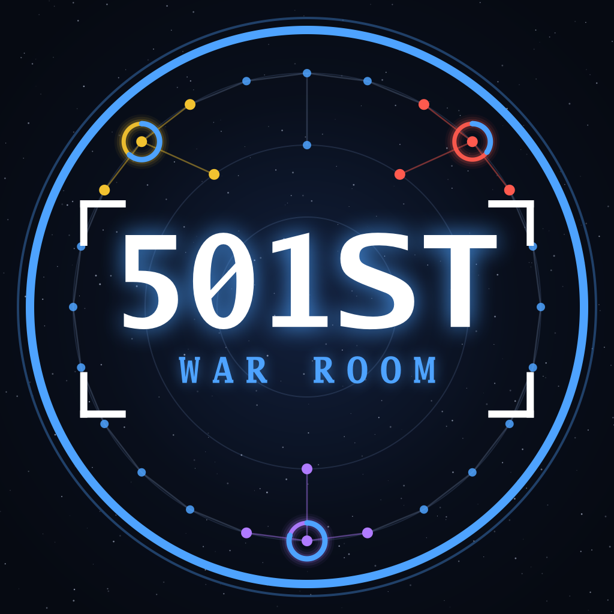

# 501st War Room: Discord Bot

**501st War Room** is a Discord bot that keeps the Helldivers 2 Galactic War inside the 501st's server. It posts the war map, the current Major Order and the busiest fronts in one message that updates itself every 5 minutes, announces each new Major Order once, and answers lookups for any planet, so the battalion can follow the war without the companion app.

Created by **Abubakr Elmallah** on **November 21, 2026**.

[**Add 501st War Room to Your Discord Server**](https://discord.com/oauth2/authorize?client_id=1574183300782886962&permissions=117760&scope=bot+applications.commands)

<a href="https://discord.com/oauth2/authorize?client_id=1574183300782886962&permissions=117760&scope=bot+applications.commands">
  
</a>

## Features

- **War Room:** One message in a channel the admins pick, edited in place every 5 minutes: the Major Order with live progress bars, the five busiest fronts, and a fresh map picture. The channel never fills up.
- **War Map:** A 1200 x 1200 picture of the galaxy: every planet in its owner's color, supply lines, active battles ringed in the enemy's color with a blue arc for liberation, and Major Order targets in brackets.
- **New Major Order Alerts:** Each new Major Order is posted once, with an optional role ping. Setting up the war room never re-announces an order that is already running, and a restart never posts one twice.
- **Planet Lookup:** Owner, liberation or defense progress, Helldivers on the planet, biome, hazards and supply lines, with names suggested as you type.
- **Backup Feed:** If the community API is down, the bot switches to Arrowhead's official feed on its own. If both are down, it keeps the last good data and says how old it is.

## Commands

| Command | Description |
| --- | --- |
| `/warroom set channel [role]` | Put the auto-updating war room in a channel, with an optional role to ping for new Major Orders (needs Manage Server) |
| `/warroom clear` | Turn the war room off in this server (needs Manage Server) |
| `/map` | Post the latest war map |
| `/major-order` | Show the current Major Order: briefing, each task with progress, reward and time left |
| `/planet name` | Look up one planet: who holds it, liberation, Helldivers there, sector and supply lines |
| `/help` | Show how to use the 501st War Room |

## Getting Started

1. **Install Go 1.27 or newer** ([go.dev/dl](https://go.dev/dl/), or `brew install go`).

2. **Clone the project:**

   ```bash
   git clone https://github.com/TheAbubakrAbu/501st-War-Room.git
   cd 501st-War-Room
   ```

3. **Create a `.env` file** in the root of the project containing your Discord bot token:

   ```
   DISCORD_TOKEN=your-bot-token
   ```

   `SUPER_CONTACT` is optional: it sets the `X-Super-Contact` header the community API asks clients to send (the default is `501st-war-room`).

4. **Run the bot:**

   ```bash
   ./run.sh
   ```

   Settings are saved in `data.nosync`, which iCloud skips.

5. **Invite it** with the scopes `bot` and `applications.commands` and the permissions View Channel, Send Messages, Embed Links, Attach Files and Read Message History (`117760`):

   ```
   https://discord.com/oauth2/authorize?client_id=1574183300782886962&permissions=117760&scope=bot+applications.commands
   ```

   Mention All Roles is only needed if the ping role does not allow anyone to mention it. `/help` builds the same link for whichever bot answers it.

To check everything without Discord or the network, run the self-test. It pushes saved API replies through the whole bot and checks every reply against Discord's limits:

```bash
go run ./cmd/warroom --self-test
```

To draw the map from live data (or from the saved replies with `--fixtures`) and print the war-room embed as JSON:

```bash
go run ./cmd/warroom --preview "$TMPDIR/map.png"
```

The planet names built into the bot come from [`internal/source/planets.json`](internal/source/planets.json). When new planets appear in the game, regenerate it:

```bash
go run ./tools/planets
```

The logo, [`logo.png`](logo.png), is drawn in the map's style by `go run ./tools/logo`. It is every embed's thumbnail (served from this repository) and the app icon to upload in the Discord Developer Portal. The same command draws [`banner.png`](banner.png), the profile banner to upload on the portal's Bot page. What goes on each portal page is in [`docs/discord-listing.md`](docs/discord-listing.md), and [`docs/discord-settings.md`](docs/discord-settings.md) is the step-by-step checklist for setting it all up.

## Project Layout

Each package under [`internal`](internal) does one job.

| Package | What it holds |
| --- | --- |
| `cmd/warroom` | Startup, flags and shutdown |
| `war` | The war as plain values: planets, defenses, Major Orders, and the math and task text |
| `source` | The community API, Arrowhead's official API, the fallback between them, and the planet names |
| `render` | Drawing the map PNG with the Go fonts |
| `poller` | The 5-minute loop: fetch, draw, swap in the new data |
| `store` | One small settings file per server |
| `bot` | Discord: commands, replies, planet search, the war room and announcements |
| `selftest` | The checks behind `--self-test` |
| `fixtures`, `sample` | Real API replies saved on November 21, 2026, and snapshots built from them |
| `tools/planets` | Regenerates the built-in planet names |
| `tools/logo` | Draws `logo.png` and `banner.png` |

The conventions every reply follows are written at the top of [`internal/bot/theme.go`](internal/bot/theme.go), the same ones [Sabacc Droid](https://github.com/TheAbubakrAbu/Sabacc-Droid) and [Aurebesh Droid](https://github.com/TheAbubakrAbu/Aurebesh-Droid) follow, and the self-test checks them. Every embed starts from one helper that gives it its colored bar and the logo as its thumbnail. On top of those, times inside embeds are Discord timestamps, so each reader sees their own time zone, and every war reply's footer says how fresh the data is.

## Hosting

The bot runs on an Oracle Cloud server as the systemd service `war-room`, beside Sabacc Droid and Aurebesh Droid, with its memory capped at 100 MB.

On every push to `main`, the [GitHub Actions workflow](.github/workflows/deploy.yml) runs the tests, builds a Linux binary and runs its self-test, and only if all of that passes, publishes it as the `nightly` pre-release (`LinuxBinary`) and restarts the bot on the server through a deploy key that can only run fixed targets. When the bot starts, [`start-worker.sh`](start-worker.sh) downloads the `nightly` binary and runs it, falling back to the last downloaded copy if GitHub is unreachable. The fonts and planet names are compiled into the binary; settings live in `data/`. The server checks the bot every 2 minutes and messages the owner on Discord if it goes down.

## More Star Wars

- **[Sabacc Droid](https://github.com/TheAbubakrAbu/Sabacc-Droid)**: A Discord bot for playing Sabacc, the Star Wars card game, with up to 8 players. [Add it to your server](https://discord.ly/sabaac-droid).
- **[Aurebesh Droid](https://github.com/TheAbubakrAbu/Aurebesh-Droid)**: A Discord bot that translates text into Aurebesh and 13 more Star Wars scripts. [Add it to your server](https://discord.ly/aurebesh-droid).
- **[Datapad | Aurebesh Translator](https://apps.apple.com/us/app/datapad-aurebesh-translator/id6450498054?platform=iphone)**: An immersive Aurebesh translator with a themed keyboard.
- **[Aurebesh Translator](https://apps.apple.com/us/app/aurebesh-translator/id6670201513?platform=iphone)**: A free, offline, ad-free translator.

## Privacy & Data

**501st War Room** respects your privacy:
- **No Personal Data Collected or Stored:** The bot stores only server, channel, message and role IDs, and the IDs of Major Orders it has announced. It never reads messages.
- **War Data:** From the [Helldivers 2 Community API](https://github.com/helldivers-2/api), with Arrowhead's official feed as a backup. Planet name capitalization comes from [helldivers-2/json](https://github.com/helldivers-2/json).
- **Secure & Compliant:** Fully follows Discord's Terms of Service and Privacy Policy.

Fan-made and not affiliated with or endorsed by Arrowhead Game Studios or Sony Interactive Entertainment.

## License

This project is licensed under the [MIT License](LICENSE). Feel free to use, modify, and distribute the code, but please provide attribution.

## Feedback & Contact

I'd love to hear your thoughts! Open an issue, or reach out with feedback, feature requests, or questions:
- **Email:** contact@abubakrelmallah.com
- **Website:** [abubakrelmallah.com](https://abubakrelmallah.com/)
- **LinkedIn:** [Abubakr Elmallah](https://www.linkedin.com/in/abubakr-elmallah-416a0b273/)
